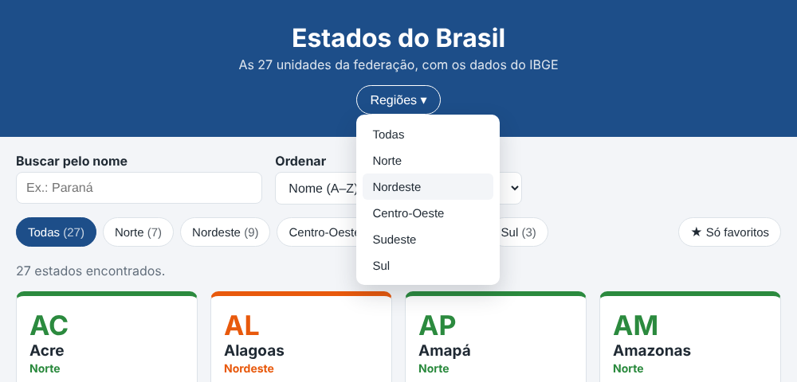
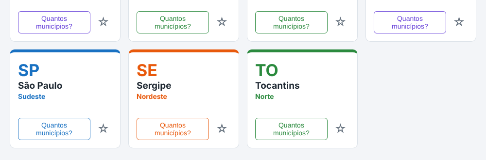

# Animando os Estados do Brasil

Agora é a sua vez de dar movimento a uma página: os **Estados do Brasil**.
Ela já funciona inteira (a busca, as regiões, a ordem, os municípios e os
favoritos), mas está parada. Você vai aplicar o que fizemos juntos na Semana
da Tecnologia.

Desta vez, os passos dizem **o que** fazer, e não **como**. A Semana da
Tecnologia é o seu mapa: consulte, reaproveite e adapte.

---

## Antes de começar

Crie um repositório novo, `estados-animados`, e copie para ele os arquivos da
pasta `estados-ponto-de-partida`. É o projeto dos estados **completo e
funcionando**: vale para todo mundo, inclusive para quem não estava na aula
em que ele foi feito.

Abra a página e use tudo: busque, clique nas regiões, troque a ordem, marque
uma estrela, clique em "Quantos municípios?". Nada se mexe.

**Se você não fez esse projeto**, o que precisa saber para esta atividade:

- os cards são criados pelo JavaScript, na função `criarCard`, e a página é
  redesenhada inteira, a cada mudança, pela `atualizarTela`;
- a região escolhida fica na variável `regiaoEscolhida`;
- o "Quantos municípios?" é tratado pela função `mostrarMunicipios`.

Todo o CSS novo vai **no fim do `style.css`**.

---

## Passo 1 — Os botões reagem ao mouse

- Os botões de região, o "Só favoritos" e o "Quantos municípios?" mudam de
  cor **aos poucos** com o mouse em cima, e não de uma vez.
- O "Quantos municípios?", com o mouse em cima, fica com o fundo na cor da
  região do card e o texto branco.

  > **Dica:** a cor da região de cada card já está na variável
  > `--cor-regiao`.

- A estrela cresce um pouco com o mouse em cima, suavemente.

**Funcionou se:** passando o mouse nos botões, as cores mudam suaves na ida e
na volta, e a estrela cresce.

---

## Passo 2 — Os cards sobem

Com o mouse em cima, o card sobe um pouco e ganha uma sombra, suavemente, sem
empurrar os outros cards.

**Funcionou se:** o card sobe e desce suave, e os vizinhos não se mexem.

---

## Passo 3 — Os cards surgem

Cada card aparece com uma animação de entrada: surge de baixo, de invisível
para visível.

Repare: como a página é redesenhada a cada mudança, os cards surgem de novo a
cada letra digitada na busca, a cada região escolhida e a cada estrela
marcada. Isso é esperado, e até ajuda a perceber o que mudou.

> **Cuidado:** os cards cinza do carregando também têm a classe `estado`, e
> já têm a animação deles (piscar). A entrada não pode valer para eles. O
> seletor `.estado:not(.esqueleto)` quer dizer "os elementos com a classe
> `estado`, **menos** os que também têm a classe `esqueleto`".

**Funcionou se:**

- ao carregar, e a cada busca, os cards surgem de baixo;
- com o **3G** na aba Network, os cards cinza continuam piscando.

---

## Passo 4 — Um menu suspenso de regiões

No topo, embaixo do subtítulo, um menu "Regiões ▾" que abre para baixo com o
mouse em cima, como o "Programação" da Semana da Tecnologia.

Copie este HTML para dentro do `<header>`, logo depois do parágrafo do
subtítulo:

```html
<nav class="menu-regioes">
    <ul class="menu-lista">
        <li class="tem-submenu">
            <button type="button" class="menu-botao">Regiões ▾</button>
            <ul class="submenu">
                <li><button type="button" class="opcao-regiao" data-regiao="">Todas</button></li>
                <li><button type="button" class="opcao-regiao" data-regiao="Norte">Norte</button></li>
                <li><button type="button" class="opcao-regiao" data-regiao="Nordeste">Nordeste</button></li>
                <li><button type="button" class="opcao-regiao" data-regiao="Centro-Oeste">Centro-Oeste</button></li>
                <li><button type="button" class="opcao-regiao" data-regiao="Sudeste">Sudeste</button></li>
                <li><button type="button" class="opcao-regiao" data-regiao="Sul">Sul</button></li>
            </ul>
        </li>
    </ul>
</nav>
```

O resto é com você, no CSS:

- a lista fica escondida, e desce suave quando o mouse está em cima de
  "Regiões ▾", **por cima** da página, sem empurrar nada;
- ela também abre pelo teclado, com Tab;
- dá para levar o mouse até as opções sem a lista fechar;
- as opções são do tamanho da lista inteira, sem a cara de botão, e mudam de
  fundo com o mouse em cima.

**Funcionou se:**

- a lista desce suave com o mouse em "Regiões ▾" e sobe quando ele sai;
- apertando Tab, a lista abre quando o foco chega em "Regiões ▾".

(Por enquanto, clicar nas opções não faz nada: é o próximo passo.)



---

## Passo 5 — O menu filtra

Clicar numa opção do menu faz o mesmo que clicar no botão daquela região, lá
embaixo: só aparecem os estados da região, e o botão dela fica destacado.

> **Dicas:**
>
> - Os botões de região lá de baixo já fazem isso. Procure, no `script.js`,
>   o que acontece no clique deles.
> - Depois do clique, o foco fica na opção, e o `:focus-within` mantém o
>   menu aberto. O `opcao.blur()` tira o foco de um elemento.

**Funcionou se:**

- escolhendo **Sul** no menu, aparecem os 3 estados do Sul, e o botão Sul
  (lá embaixo) fica azul;
- tirando o mouse do menu, a lista fecha.

---

## Passo 6 — O "Buscando..." pisca

Enquanto a quantidade de municípios está sendo buscada, a mensagem
"Buscando..." pisca, com a **mesma** animação dos cards cinza do carregando.

- No CSS: a mensagem com a classe `buscando` pisca.
- No JavaScript: a `mostrarMunicipios` coloca a classe `buscando` quando a
  busca começa e tira quando ela termina, **tenha dado certo ou não**.

> **Dica:** o JavaScript decide **quando**; o CSS decide **como**. E qual
> bloco do `try` roda nos dois casos?

**Funcionou se:**

- com o 3G, o "Buscando..." pisca, e para quando o número aparece;
- com o Offline, a mensagem de erro aparece parada, sem piscar.

---

## Passo 7 — Sobre os dados

No fim da página, uma seção com perguntas que abrem e fecham. Copie este HTML
para dentro do `<main>`, depois da lista de estados:

```html
<section class="sobre">
    <h2>Sobre os dados</h2>
    <details class="duvida">
        <summary>De onde vêm os dados?</summary>
        <p class="duvida-resposta">Da API de localidades do IBGE, gratuita e sem cadastro.</p>
    </details>
    <details class="duvida">
        <summary>Por que o Distrito Federal aparece entre os estados?</summary>
        <p class="duvida-resposta">Ele não é um estado, mas é uma das 27 unidades da federação, e o
            IBGE o lista junto com elas.</p>
    </details>
    <details class="duvida">
        <summary>Os favoritos ficam salvos onde?</summary>
        <p class="duvida-resposta">No seu navegador, com o localStorage. Em outro computador, eles não
            aparecem.</p>
    </details>
</section>
```

No CSS:

- cada pergunta é uma caixa branca, com borda e cantos arredondados;
- aberta, a pergunta fica na cor principal;
- a resposta surge suave quando a pergunta abre.

**Funcionou se:** as perguntas abrem e fecham, e a resposta surge com
animação.



---

## Se sobrar tempo

- **Um card depois do outro.** Na `criarCard`, cada card espera um pouquinho
  mais que o anterior para surgir, como os elementos do destaque da Semana
  da Tecnologia. No JavaScript, `card.style.animationDelay = '0.1s'` muda o
  atraso de um elemento. (Dica: a `renderizarEstados` sabe a posição de cada
  estado na lista.)
- **A seta que gira.** O "▾" do menu gira quando a lista abre.
- **O menu no celular.** No celular, não existe "mouse em cima": a lista do
  menu fica sempre aberta, embaixo de "Regiões ▾", ou abre com um clique,
  como o ☰ da Semana da Tecnologia.

---

## Para entregar

Faça o commit e envie para o GitHub, mesmo que incompleto.
